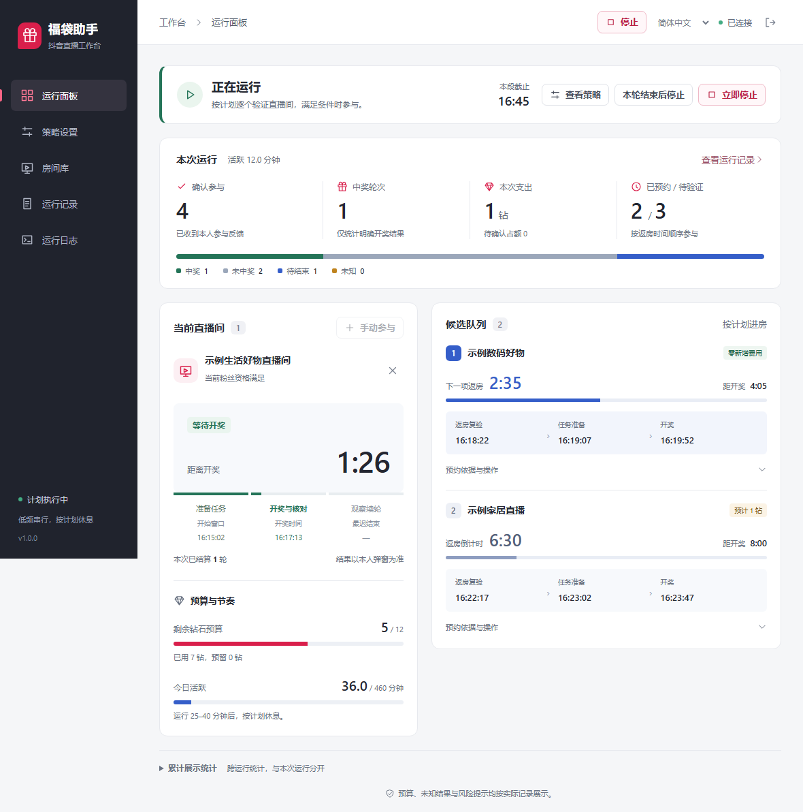
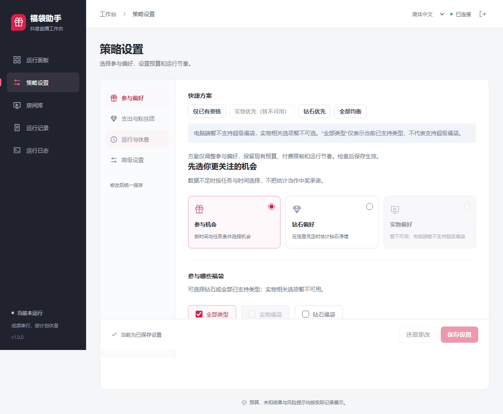
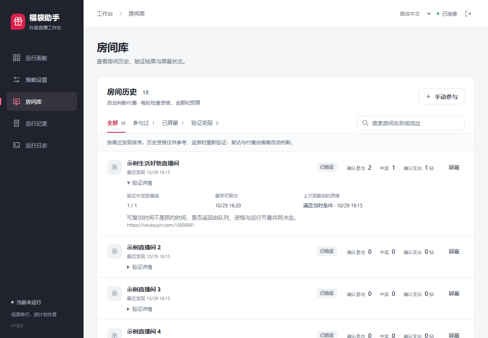
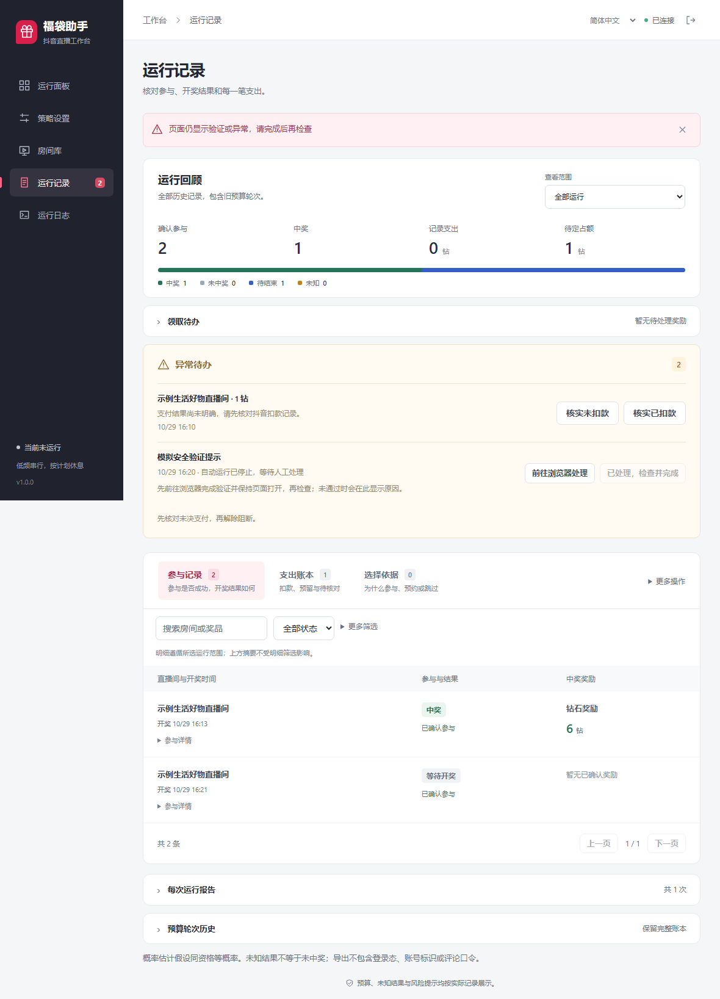

# 福袋助手 · Auto LuckBag

面向 Windows 的抖音直播福袋桌面工具：发现直播间、验证参与条件、按开奖时间预约返房，在设定的预算和运行计划内完成已支持的任务。

**v1.0.0** · Electron + Vue + TypeScript + Playwright

[快速上手](#快速上手) · [界面与功能](#界面与功能) · [常见问题](#常见问题) · [本地开发](#本地开发)

> **支持范围：** 当前使用电脑端抖音网页，支持已适配的普通福袋。**暂不支持需要手机 App 参与的超级福袋**，实物相关选项已禁用；“全部”仅包含已支持的类型。安卓手机和模拟器执行端尚未实现。



*截图来自当前界面的离线测试，使用虚构房间和演示数据，仅说明功能布局，不代表真实中奖或收益。点击图片可查看大图。*

## 它能做什么

| 你关心的事情 | 应用如何处理 |
| --- | --- |
| 多个直播间开奖时间不同 | 逐房验证，合格福袋加入预约队列，按可行时间返房；参与仍为单房串行 |
| 不想一直盯着倒计时 | 展示返房、任务准备、开奖时间及当前阶段进度 |
| 开奖后马上续上下一袋 | 核对旧轮后观察新轮；远期新轮可预约，不拖延已有预约 |
| 控制入团、点亮费用 | 同时检查总预算、每日支出、单次费用、主播累计及新开团数量 |
| 不希望新增费用 | 可选择“仅已有资格”，每轮仍重新确认条件 |
| 定时运行和休息 | 支持定时结束、计划休息、延长当前运行、立即停止或本轮结束后停止 |
| 查看实际参与情况 | 区分提交、本人参与确认和开奖结果，保留参与记录、支出账本及选择依据 |
| 遇到验证码或异常 | 已识别风险停止自动运行，进入异常待办，由用户在同一浏览器会话中处理 |

可执行已识别的一键评论、关注、预算允许的粉丝团任务及参与按钮。分享、无法确认的条件、费用或身份会跳过；不会因反馈迟到重复评论或付款。

## 界面与功能

### 运行面板：看清当前任务和下一站

上方集中显示本次参与、结果和支出，下方同时展示当前直播间与候选队列。运行后策略区收起，主要空间留给任务状态。

- **当前直播间：** 准备任务 → 开奖与核对 → 观察续轮，进度与阶段联动。
- **候选队列：** 返房倒计时、任务准备时间、开奖时间和预计新增费用。
- **预算与节奏：** 剩余额度、预留金额和今日活跃时长。
- **运行控制：** 可停止或延长定时运行；延长不会重置每日额度和休息计划。

### 策略设置：先选偏好，再确定支出与节奏



设置分为参与偏好、支出与粉丝团、运行与休息、高级设置。可使用“仅已有资格”“钻石优先”“全部均衡”快捷方案，再按需要调整；方案不会扩大预算或更改运行节奏。修改策略需先停止运行，并保存设置。

### 房间库：关注复访状态，减少逐房配置



按最近发现查看房间，支持搜索与状态筛选。卡片显示验证情况、最早复访时间和历史资格；复访及是否允许新增费用由策略判断，停止后可屏蔽房间。**历史资格仅作参考，返房时会重新验证。**

### 运行记录：结果、费用和异常分开看



- **参与记录：** 查看本人确认参与，以及中奖、未中奖、等待结果或未知。
- **支出账本：** 区分已扣款与待核对，未决金额继续占用预算。
- **选择依据：** 查看入选、跳过或预约冲突的原因。
- **异常待办：** 前往浏览器人工处理，再点击“已处理，检查并完成”；检查通过后仍需手动启动。

运行日志单独展示最近 500 条事件，**最新在最上方**，支持搜索和暂停自动滚动。历史记录中的物品明细可以保留展示，不表示当前支持超级福袋参与。

## 快速上手

1. **启动并登录。** 在打开的浏览器中完成抖音登录，等待应用确认账号；源码启动见下方[本地开发](#本地开发)。
2. **保存策略。** 选择参与偏好、粉丝团策略、预算和运行节奏。不希望新增费用时，选择“仅已有资格”并核对后保存。
3. **设置本次时长。** 在运行面板的“本次运行选项”设置发现入口和定时停止，点击“开始运行”。
4. **查看进度。** 面板展示任务、预约和等待原因；计划休息不执行页面任务，检查通过后自动恢复。
5. **结束或处理异常。** 随时点击“立即停止”。出现异常待办时按提示人工处理，支付待核对须先核实实际账单。

关闭主窗口会缩到托盘；完全结束应用请使用托盘“退出”。电脑应保持唤醒，应用重启不会自动恢复任务。

### 几个容易混淆的设置

| 设置 | 含义 |
| --- | --- |
| 基础预算 | 应用账本中的支出上限，不是钱包余额，不会随每次启动重置 |
| 准备窗口（默认 45 秒） | 开始执行任务的时间窗口；返房还需提前加载和复验，复杂任务可能更早准备 |
| 计划休息 | 默认每段运行 25–40 分钟、休息 10–20 分钟，每日活跃最多 460 分钟 |
| 开始新预算轮次 | 停止且无预留、未决款或未解除风险时可手动操作，重置本轮及每日支出计数，保留历史账本 |
| 结果未知 | 未取得可归属本轮的本人明确结果，不算未中奖，也不猜测中奖 |

已保存配置优先于源码默认值。新预算轮次不重置单主播累计支出或每日新开团数量；旧轮奖励不计入新轮追加额度。

## 常见问题

**能参与超级福袋、0 元购实物吗？**

当前不支持需要手机 App 参与的超级福袋。安装模拟器不会自动让本项目获得安卓操作能力。

**为什么提前进房，却还在等待？**

返房验证与任务执行是两个阶段。先确认身份、倒计时和条件，再等到准备窗口执行任务，不是进房就立即付款或评论。

**为什么没有同时参与多个房间？**

候选可以同时预约，实际参与串行进行。调度考虑加载、任务、开奖核对及切换的完整占用时间，冲突候选可能被跳过。

**验证码能自动处理吗？**

不能。已识别的滑块、手机验证等风险会停止运行并建立异常待办。人工处理后检查通过才能解除，关闭提醒不等于解除风险。

**付款结果不明怎么办？**

先查抖音实际账单，再到支出账本核对。待核对金额仍占预算并阻断运行，不能通过重启、清空日志或重置统计释放。

**是否保证中奖或不会触发风控？**

不保证。低频和休息只是运行约束，不代表平台授权或安全阈值。页面变化可能导致识别失败；使用前应了解并遵守平台规则。

## 本地开发

需要 Windows、Node.js（依赖声明支持 18 或 20+）和 npm。

```bash
git clone https://github.com/koigxx/auto-luckBag.git
cd auto-luckBag
npm install
npx playwright install chromium
npm run dev
```

应用优先使用 Playwright Chromium，缺失时尝试本机 Microsoft Edge；浏览器测试需要 Playwright Chromium。

| 命令 | 用途 |
| --- | --- |
| `npm run typecheck` | TypeScript / Vue 类型检查 |
| `npm test` | 纯逻辑、全请求拦截的浏览器夹具及调度回归 |
| `npm run test:smoke` | 普通构建、隔离配置的 Electron 和界面冒烟 |
| `npm run build` | 编译代码，不生成安装包 |

测试使用虚构数据、内存账本或隔离用户目录，不通过真实评论、关注或付款验证去重。`build:win`、`build:win:dir`、`build:win:cn` 仅用于按需发行，不属于日常回归。

## 数据与更多文档

配置和运行明细保存在 Electron 用户数据目录：`config.json`、`runtime-v2.json`、`auth.json`。升级备份使用 `config.json.before-runtime-v2.bak`。**不要公开登录文件、真实账本或 Cookie**；反馈问题优先提供脱敏导出和遮盖个人信息的截图。

- [使用说明](docs/USAGE.md)：操作、预算、异常处理及升级回退。
- [迭代清单](docs/ITERATION_PLAN.md)：设计范围与平台规则研究。
- [交付记录](docs/DELIVERY.md)：历史版本验证及限制，以对应版本为准。
- [界面改造记录](docs/UI_REDESIGN.md)：界面设计与验收。
- [文档图片说明](docs/images/README.md)：截图来源与更新方式。
